<p align="center">
  
</p>

<h1 align="center">Capsight</h1>

<p align="center">
  <a href="https://zerovectorlabs.github.io/capsight/"></a>
  <a href="https://github.com/ZeroVectorLabs/capsight/releases/latest"></a>
  <a href="LICENSE"></a>
  <a href="https://github.com/ZeroVectorLabs/capsight/actions/workflows/ci.yml"></a>
  <a href="https://github.com/ZeroVectorLabs/capsight/stargazers"></a>
</p>

<p align="center">
  <b>Open a capture. See what really happened.</b><br>
  A packet-capture analyzer that runs entirely in your browser: traffic analytics, a network diagram,
  threat detection mapped to MITRE ATT&amp;CK, attack-flow reconstruction, extraction of files,
  credentials and indicators, and findings reports as PDF, web page, Word or Markdown.
</p>

<p align="center">
  <a href="https://zerovectorlabs.github.io/capsight/"><b>Open Capsight in your browser</b></a>
  &nbsp;·&nbsp;
  <a href="https://zerovectorlabs.github.io/capsight/attack_scenario.pcap">Download the sample attack capture</a>
  &nbsp;·&nbsp;
  <a href="docs/media/capsight_demo.mp4">Watch the 65-second demo</a>
</p>

<p align="center">
  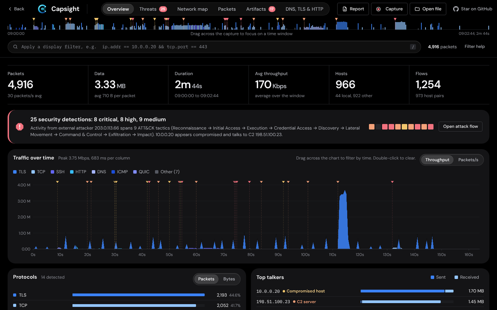
</p>

---

## Contents

- [Why Capsight](#why-capsight)
- [Quick start](#quick-start)
- [Features](#features)
  - [Overview](#overview)
  - [Threats and attack flow](#threats-and-attack-flow)
  - [Network map](#network-map)
  - [Packets](#packets)
  - [Artifacts](#artifacts)
  - [DNS, TLS and HTTP](#dns-tls-and-http)
  - [Findings report](#findings-report)
  - [Capture live traffic](#capture-live-traffic)
- [How to work with it](#how-to-work-with-it)
- [Filter syntax](#filter-syntax)
- [Packet list](#packet-list)
- [Detections](#detections)
- [Supported captures](#supported-captures)
- [The sample capture](#the-sample-capture)
- [Privacy](#privacy)
- [Development](#development)
- [Project layout](#project-layout)
- [Limitations](#limitations)
- [Contributing](#contributing)
- [License](#license)

## Why Capsight

Wireshark tells you what every packet says. Capsight tells you what happened. Drop in a `.pcap` or `.pcapng` and within seconds you see:

- the shape of the traffic and who the busy hosts are,
- whether an attack is in the capture, which machines played which role, and every step in order,
- the files, passwords and indicators that crossed the wire, ready to hand to your threat-intel tools,
- a findings report you can send to your team as a PDF, web page, Word document or Markdown.

It is a single HTML file with no server, no install and no network requests. The capture never leaves your machine.

## Quick start

**Online:** open **https://zerovectorlabs.github.io/capsight/** and drop a capture on the page. The site is the same single HTML file served by GitHub Pages; your capture is still decoded locally and never uploaded.

**Offline:** download [`dist/capsight.html`](dist/capsight.html), open it in Chrome, Edge, Firefox or Safari, and drop a capture anywhere on the page or click **Choose a capture file**.

Want to see it work first? Click **Open the sample attack** on the start page. It loads a built-in capture containing a full intrusion.

<p align="center">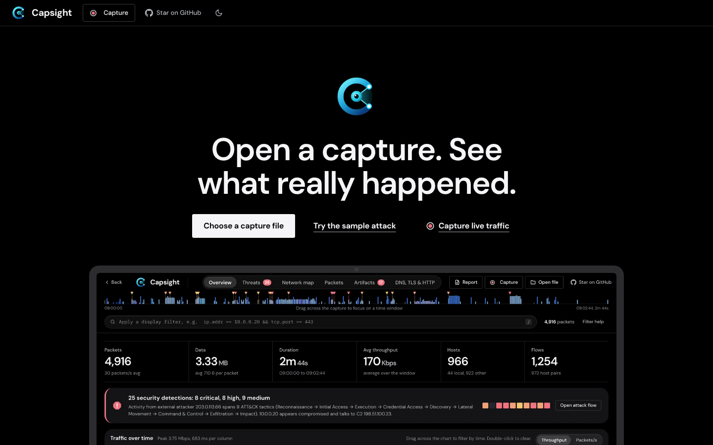</p>

## Features

### Overview

Headline numbers (packets, data, duration, throughput, hosts, flows), stacked traffic over time by protocol with markers where attacks happened, protocol mix, top talkers split into sent and received, services by server port, packet-size distribution and TCP flag counts.

The **capture strip** under the header shows the whole capture at a glance, one column per moment coloured by its busiest protocol, with red markers for attack steps. Drag across it (or across the traffic chart) to focus every view on that time window.

<p align="center">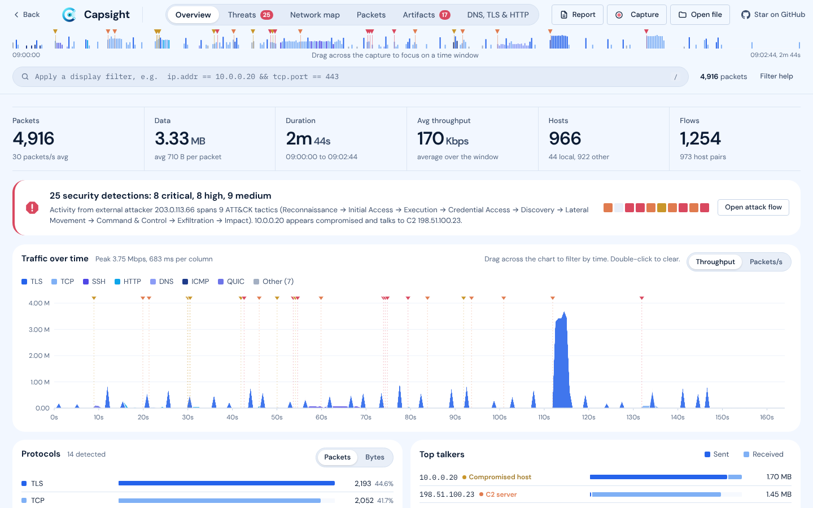</p>

### Threats and attack flow

Every detection is mapped to a MITRE ATT&amp;CK technique, ranked by severity and linked to its evidence packets.

- **What happened**: a plain-language summary of the incident.
- **Kill chain**: the nine ATT&amp;CK tactics in attack order, lit up where activity was found. Select one to narrow the list.
- **Attack flow**: a sequence diagram with one column per actor (attacker, compromised host, C2 server, victims) and a numbered arrow per step in time order.
- **Detection cards**: what was seen, the evidence (sample requests, commands typed in a reverse shell, ports found open), whether it looks successful, and buttons to show the packets or follow the TCP stream.

<p align="center">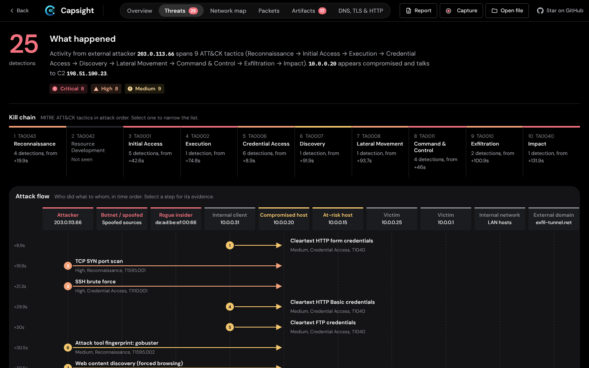</p>
<p align="center">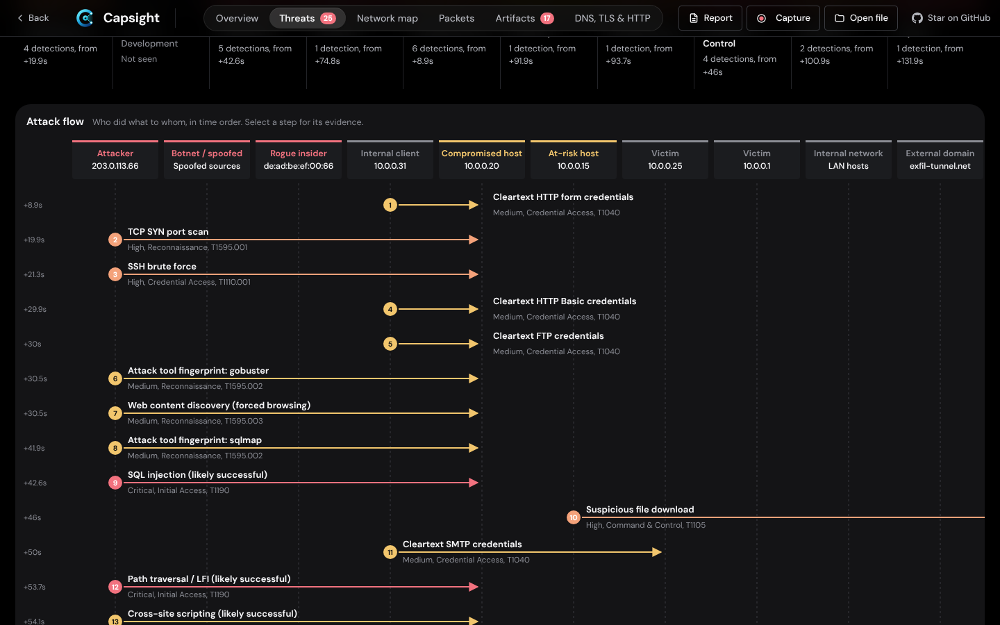</p>

### Network map

A network diagram drawn the way you would sketch it in draw.io: the internet above your local network, a box per device with an icon for its kind (gateway, server, workstation, internet host), connectors routed at right angles through the gaps between boxes, and attack paths drawn as coloured arrows carrying the numbers of the attack steps. Hosts that only talked to one machine are folded into "+N hosts" groups. Boxes can be dragged; hover a host to see its traffic, double-click to filter to it.

<p align="center">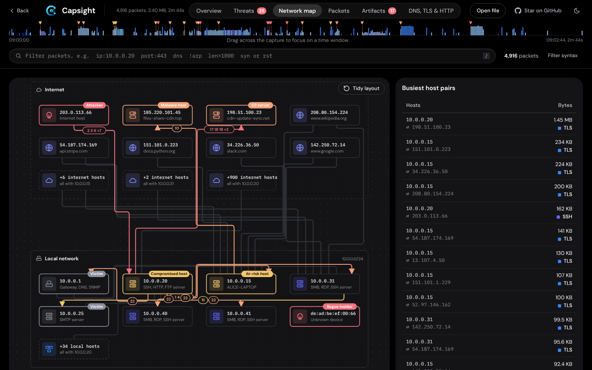</p>

### Packets

A virtualized packet list that stays responsive on large captures, a Wireshark-style [filter bar](#filter-syntax), a protocol tree linked both ways to a hex view (hover a field to highlight its bytes, click a byte to find its field), and full TCP stream reassembly with client and server coloured separately. Packets that are evidence in a detection carry a severity marker.

<p align="center">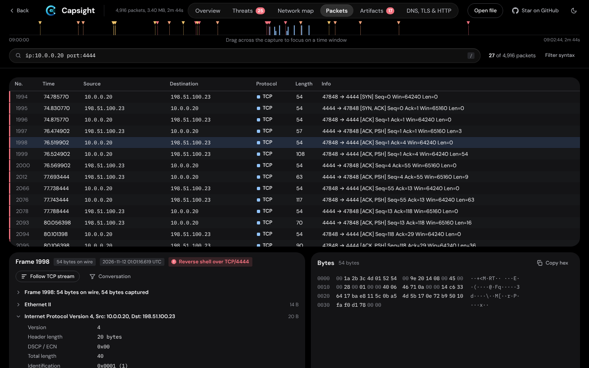</p>

### Artifacts

Everything worth keeping from the capture, in four parts.

**Files.** Reassembled from HTTP (including chunked and gzip-encoded bodies, form and multipart uploads), FTP data channels, SMTP attachments and raw TCP transfers. Each file shows its real type from its contents, its size, where it came from, MD5 and SHA-256 hashes and a VirusTotal lookup link. Executables and scripts are flagged, and an executable pretending to be an image or document is flagged critical. Images open in a gallery. Executables are never rendered and are saved inside a .zip so they cannot be opened by accident.

**Download all artifacts (.zip)**, at the top of the tab, saves everything in one archive: every recovered file sorted into `files/executables`, `files/images`, `files/documents`, `files/archives` and so on, plus `manifest.csv` (type, size, MD5, SHA-256, origin and flags per file), `credentials.csv`, `detections.csv` and `indicators.txt`.

<p align="center">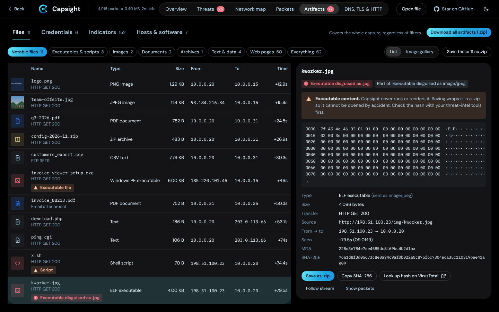</p>
<p align="center">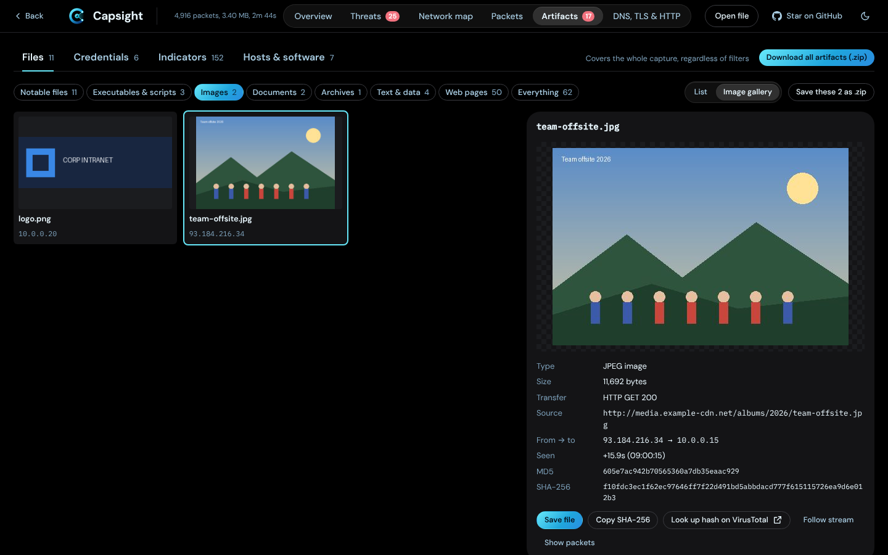</p>

**Credentials.** Logins and secrets that crossed the network in cleartext: HTTP Basic and login forms, FTP, POP3, IMAP, SMTP AUTH, Telnet sessions, SNMP community strings, bearer tokens and API keys, and passwords, keys or private-key blocks found in other cleartext traffic. Secrets are masked until you reveal them, and the list exports as CSV.

<p align="center">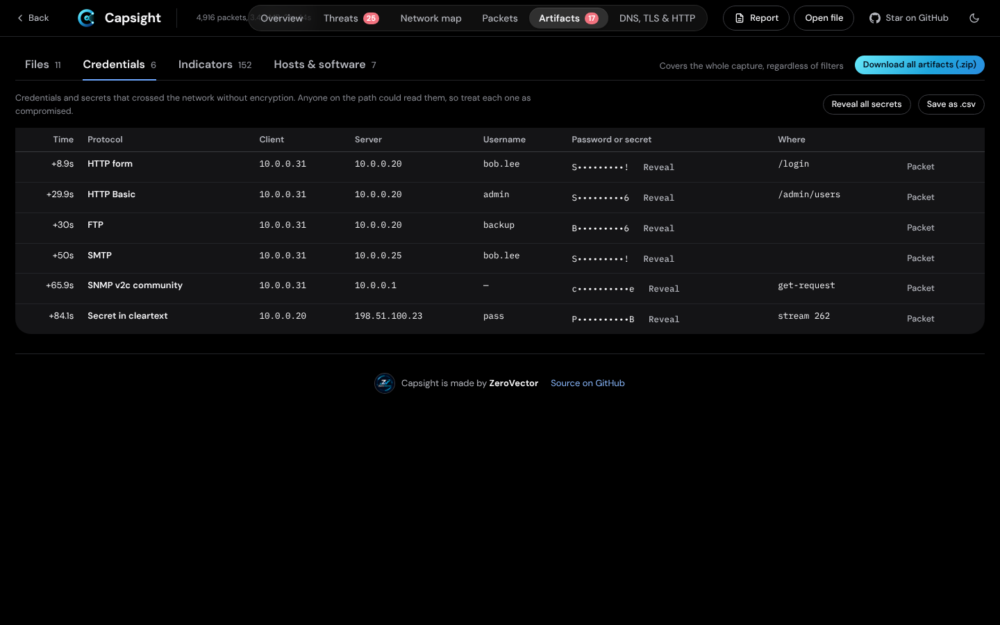</p>

**Indicators.** External IP addresses, domains (from DNS, TLS SNI and HTTP Host), URLs, user agents (attack tools flagged), email addresses and file hashes. Copy or save them all as text for a blocklist, SIEM search or threat-intel lookup.

<p align="center">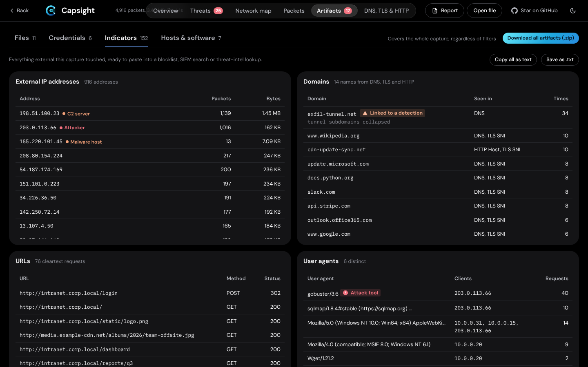</p>

**Hosts and software.** A host inventory: DHCP hostname, MAC address, likely operating system from TTL, services each host answered on, and software seen in banners and headers (web and SSH servers, FTP and mail servers, HTTP clients).

<p align="center">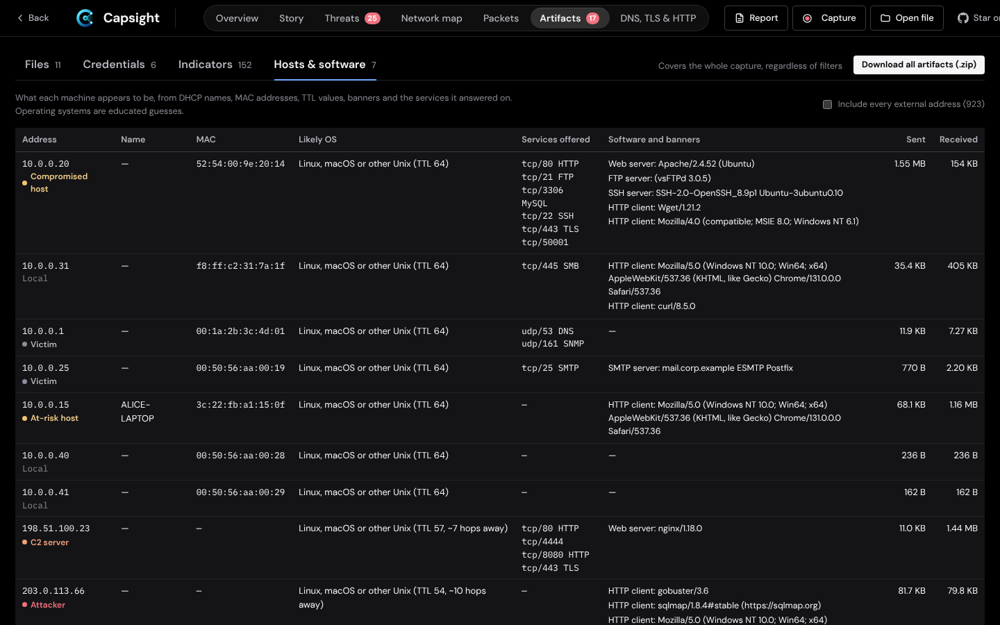</p>

### DNS, TLS and HTTP

Queried domains grouped by registered domain with their answers and NXDOMAIN counts, TLS server names with ALPN and bytes, and every cleartext HTTP request with status and user agent. Click a row to jump to its packets.

### Findings report

Click **Report** in the top bar to download a write-up of the capture as a **PDF**, a **web page**, a **Word** document or **Markdown**. It is short and to the point: the verdict, the attacker, compromised hosts and C2 at a glance, what to do now, the attack flow diagram and the network map, a timeline of every detection with its MITRE ATT&amp;CK tactic and technique, then only the indicators, cleartext passwords and suspicious files that matter. Passwords are masked unless you choose to include them. A clean capture gets a report that says so, and that no known attack pattern matched. The PDF is made with your browser’s print window (choose **Save as PDF**); like everything else, the report is built in the page and never uploaded.

<p align="center">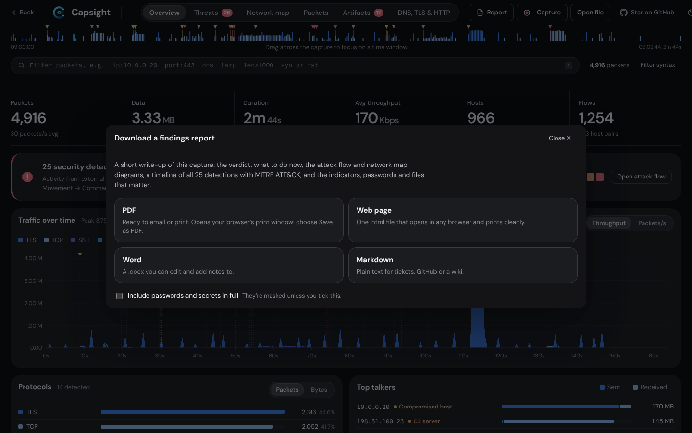</p>

### Capture live traffic

Click **Capture live traffic** on the start page, or **Capture** in the top bar, to open the Capture page. Browsers can’t read network ports, so recording is done by **Capsight Capture**, a small open-source helper in [`capture/`](capture/) that runs on your computer in the background ([download](https://zerovectorlabs.github.io/capsight/capsight-capture.zip)); the page shows how to start it and connects on its own. From the page you see what your computer can capture, pick the network port from a drop-down list, set an optional filter and stop condition, and watch live counters and a traffic graph. Finished captures are saved in your browser under **Saved captures**, where you can open, download or delete them; they’re removed after the number of days you choose. On a Mac, run `bash "Capsight Capture.command"` in Terminal; on Windows, install [Npcap](https://npcap.com) and double-click `Capsight Capture.bat`; on Linux, `sudo python3 capsight_capture.py`. See [capture/README.md](capture/README.md).

## How to work with it

A typical investigation:

1. **Open the capture.** Read the threat banner on the Overview. If it is clean, scan the timeline and top talkers for anything unexpected.
2. **Open the attack flow.** Read "What happened", then walk the numbered steps. The kill chain tells you how far the attacker got.
3. **Check each detection.** Use **Show packets** to see the evidence and **Follow stream** to read the conversation (for example, the commands typed in a reverse shell).
4. **Look at the network map** to see which machines were involved and which internal hosts the attacker reached.
5. **Collect artifacts.** Hash and save suspicious files, list the exposed credentials that need resetting, and copy the indicators into your blocklist or SIEM.
6. **Write it up.** Click **Report** and send the PDF or Word file to your team, or paste the Markdown into a ticket.
7. **Dig deeper with filters.** Use Wireshark display filters such as `ip.addr == 10.0.0.20 && !tls` or `http.response.code >= 400`, right-click any packet to filter on it, or type `threat` to see only evidence packets.

Keyboard: `/` focuses the filter, arrow keys, Page Up/Down, Home and End move through the packet list, `Esc` closes dialogs. More shortcuts are listed under [Packet list](#packet-list).

## Filter syntax

Capsight reads **Wireshark display filters**, so filters you already know work as they are. The filter bar turns green when a filter is valid and red when it is not; press Enter to apply it. **Filter help** next to the packet count lists examples you can click.

| Filter | Matches |
|---|---|
| `ip.addr == 10.0.0.20`, `ip.src == 10.0.0.0/24`, `ipv6.addr`, `eth.addr == aa:bb:cc:dd:ee:ff` | Addresses and subnets |
| `tcp.port == 443`, `udp.dstport == 53`, `tcp.stream eq 12` | Ports and conversations |
| `tcp.flags.syn == 1 && tcp.flags.ack == 0`, `tcp.flags.reset == 1` | TCP flags |
| `http.request`, `http.request.method == "POST"`, `http.response.code >= 400`, `http.host contains "intranet"` | HTTP |
| `dns.qry.name matches "exfil.*"`, `tls.handshake.extensions_server_name contains "github"` | DNS and TLS |
| `frame contains "password"`, `tcp contains 47:45:54`, `tcp[13:1] == 02`, `ip[9:1] == 06` | Bytes: text or hex anywhere, or a slice counted from a protocol's start |
| `frame.len > 1000`, `frame.number <= 100`, `frame.time_relative >= 30`, `ip.ttl < 10` | Numbers, with `== != > < >= <=` or `eq ne gt lt ge le` |
| `frame.marked == 1`, `frame.ignored == 1`, `frame.comment`, `frame.coloring_rule.name == "TCP RST"` | Your marks, comments and colouring rules |
| `(dns \|\| http) && !(ip.addr == 10.0.0.31)` | Combine with `&& \|\| !` or `and or not`, and brackets |

Capsight's short forms still work too: `ip:10.0.0.5`, `port:443`, `dns:example`, `ua:sqlmap`, bare protocol names and flags (`syn`, `rst`), and `threat` for packets that are evidence in a detection.

**Clear filter**, next to the packet count, removes the filter text, every chip and the selected time window in one click.

## Packet list

The Packets tab works the way Wireshark does.

- **Right-click a packet** (long-press on a phone) for:
  - **Apply as filter** and **Prepare as filter**: Selected, Not Selected, …and Selected, …or Selected, …and not Selected, …or not Selected. The filter is built from the column you clicked.
  - **Conversation filter** (Ethernet, IPv4/IPv6, TCP, UDP) and **Colourise conversation** with ten colours.
  - **Follow** the TCP, UDP, TLS or HTTP stream.
  - **Mark**, **Ignore**, **Set time reference** and **Packet comment**.
  - **Copy** the summary as text or CSV, a cell, the filter, or the bytes as a hex dump, a hex stream, printable text or an escaped string.
  - **Export** the packet's bytes or the packet as `.pcapng`.
- **Right-click a field** in the packet details to filter on it, copy it or export its bytes. Double-click a field to apply it as a filter.
- **Columns:** No., Time, Source, **Src port**, Destination, **Dst port**, Protocol, Length and Info. Right-click a port to filter on it (`tcp.dstport == 80`); right-click a heading to hide or show the port columns. Columns sort when you click their heading. The **Time** column shows seconds since start, since the previous packet, time of day, UTC or epoch, and counts from your time references.
- **Colour rows** applies Wireshark's default colouring rules (TCP, UDP, HTTP, ARP, ICMP, SYN/FIN, RST and more).
- **Go to** a packet number, **Find** a packet by text, hex bytes or display filter, and see counts of displayed, marked and ignored packets in the status bar.
- **Export** the shown or marked packets as `.pcapng` (with your comments), or the packet list as CSV or text.
- **Follow stream** shows the whole conversation or one direction, as ASCII, a hex dump or raw hex, and can filter the stream in or out or save it.

| Shortcut | Action |
|---|---|
| `Ctrl+M` / `Ctrl+Shift+N` / `Ctrl+Shift+B` | Mark a packet / next marked / previous marked |
| `Ctrl+D` | Ignore a packet |
| `Ctrl+Alt+T` | Set a time reference |
| `Ctrl+Alt+Shift+T` | Follow the TCP stream |
| `Ctrl+G` / `Ctrl+F` | Go to a packet / find a packet |
| `Ctrl+.` / `Ctrl+,` | Next / previous packet in the same conversation |
| `Shift+F10` or the menu key | Open the packet menu from the keyboard |

### ARTEX-style AI attack sample

[`samples/artex_ai_attack.pcap`](samples/artex_ai_attack.pcap) is a second synthetic capture, of the kind of AI-driven intrusion that public reporting on the ARTEX framework describes (November 2026). No public capture of a real ARTEX attack exists, so it is built from the reported behaviour, with invented addresses, names and tokens and no runnable code:

- machine-speed recon that starts from the app's API map (`swagger.json`), then a port scan and endpoint fuzzing at a fixed 120 ms;
- a web shell uploaded through an open file-upload endpoint and driven with `?cmd=`;
- the same attack run replayed identically about 30 seconds later, and a "recheck loop" that polls the shell every 48 seconds;
- cloud credentials taken from the Azure instance metadata service, then Azure management and storage access;
- Active Directory recon over LDAP (with a cleartext bind), kerberoasting, an internal SMB/RDP/WinRM sweep, WinRM and SMB to the file server;
- a tool download and a staged upload to an outside server.

Open it with **Choose a capture file**. Regenerate it with `npm run sample:artex`.

## Detections

### AI-driven attacks

Capsight checks every attacker for the signs that AI agent frameworks such as ARTEX leave on the wire, and shows each sign with the packets behind it:

| Sign | What Capsight looks for | Strength |
|---|---|---|
| Read the target's API map, then used it | `swagger.json`, `openapi.json`, `robots.txt`, `llms.txt` or similar fetched first, then the paths they list requested next | strong |
| Replayed the same attack run | A run of 8 or more requests repeated step for step, in the same order, seconds or minutes later | strong |
| Recheck loop at a fixed interval | The same URL polled at least 5 times, 10 s or more apart, with under 5% variation | strong |
| Talks to an AI model API | A host in the attack connecting to OpenAI, Anthropic, Google, xAI, Mistral, Groq, OpenRouter, DeepSeek, Azure OpenAI, Bedrock and similar APIs | strong |
| Machine-speed, evenly timed requests | 20 or more requests in a burst with an even, sub-second gap | weak |
| Scripted client used by agent frameworks | User-Agents such as `python-httpx`, `aiohttp`, `Go-http-client`, LangChain or Playwright | weak |
| Kill chain at machine pace | From first contact to code execution in under three minutes | weak |

No single sign proves that an AI is driving, because fast scripts share some of them, so the verdict needs at least one strong sign. **AI-driven attack** (critical) needs a score of 5 and two strong signs; **Possibly AI-driven** (medium) needs a score of 3 and one. A host in the attack that keeps calling a model API gets **AI agent at work on compromised host**, and its steady calls are labelled as model API calls rather than C2. The attacker's role becomes **AI-driven attacker** in the attack flow, the network map and the report, which also lists AI-specific response steps. These are traffic heuristics, documented here so you can judge them.

### Everything else


| Area | What is detected | ATT&amp;CK |
|---|---|---|
| Reconnaissance | SYN, NULL, FIN, Xmas and UDP port scans (with open ports found), horizontal scans, ping and ARP sweeps, attack-tool user agents, forced browsing | T1595, T1046, T1018 |
| Initial access | SQL injection, XSS, path traversal, command injection, Log4Shell, Shellshock, Heartbleed, with signs of success read from the response | T1190 |
| Web shells | A server-script file uploaded through the app and then driven with `?cmd=` requests, with the commands run | T1505.003 |
| Credential access | SSH, FTP, RDP, SMB, database and web-login brute force; cleartext credentials (including LDAP simple binds); ARP spoofing; rogue DHCP; cloud tokens taken from the instance metadata service (Azure, AWS, Google Cloud); kerberoasting, with RC4 requests flagged | T1110, T1040, T1557, T1552.005, T1558.003 |
| Discovery | Active Directory reconnaissance over LDAP (service accounts, admins, LAPS passwords, trusts) | T1087.002 |
| Execution | Interactive and reverse shells over TCP, with the commands issued | T1059.004 |
| Lateral movement | Internal hosts probing other internal hosts on SMB, RDP, SSH, WinRM or VNC | T1021 |
| Command and control | Periodic beaconing, sessions on backdoor ports, tool and stager downloads, executables disguised as other file types, NXDOMAIN bursts (DGA), ICMP tunnels | T1071, T1571, T1105, T1036.008, T1568.002, T1095 |
| Exfiltration | DNS tunnelling (with an estimate of the data encoded), large outbound transfers | T1048.003, T1041 |
| Impact | SYN floods (including spoofed sources), ICMP floods, DHCP starvation | T1498, T1499 |

Detection is heuristic. A clean result does not prove the traffic is benign, and every finding should be confirmed against its evidence packets.

## Supported captures

- **pcap**: micro- and nanosecond timestamps, either byte order.
- **pcapng**: multiple interfaces, any timestamp resolution, enhanced, simple and obsolete packet blocks.
- **Compressed**: `.pcap.gz` and other gzip-wrapped captures are unpacked automatically.
- **Link types**: Ethernet (with 802.1Q and QinQ tags), Linux cooked v1 and v2, raw IP, BSD loopback.
- **Protocols decoded**: Ethernet, ARP, IPv4, IPv6 (with extension headers), TCP, UDP, ICMP, ICMPv6, DNS, mDNS, LLMNR, NBNS, DHCP, NTP, SNMP, TLS (ClientHello SNI and ALPN, ServerHello version), QUIC, HTTP/1.x, SSH, FTP, SMTP, POP3, IMAP, Telnet, SSDP, STUN, plus port-based labels for many more.

## The sample capture

[`samples/attack_scenario.pcap`](samples/attack_scenario.pcap) is generated, not recorded, so it is safe to share. It mixes normal office traffic with a scripted intrusion:

1. External attacker `203.0.113.66` port-scans the web server `10.0.0.20`, then runs gobuster and sqlmap against it.
2. SQL injection, path traversal (leaking `/etc/passwd`), XSS and Log4Shell probes, then an SSH brute force.
3. A command injection makes the server download a stager and open a reverse shell to C2 `198.51.100.23`; the attacker reads config files, and a second payload disguised as a `.jpg` is fetched.
4. The server beacons to the C2 every 10 seconds, sweeps the LAN and tries SMB, RDP and SSH on other hosts.
5. Customer data leaves through DNS tunnelling and a 1.4 MB upload to the C2, while a rogue insider spoofs the gateway's ARP entry and a SYN flood hits the web server.

It also carries images, PDFs, a ZIP, an FTP export, an email with an attachment and several cleartext logins, so every Artifacts view has something to show. The "executables" in it are harmless stand-ins with only the MZ or ELF header shape and a note, and all addresses are private or from documentation ranges.

Regenerate it with `npm run sample` (needs Python with scapy and Pillow). The output is byte-for-byte reproducible.

## Privacy

Capsight makes no network requests, except that while the **Capture** page is open it talks to the Capsight Capture helper at `127.0.0.1:47115` on your own computer. Captures you record are saved in your browser's own storage (IndexedDB) on this computer, never uploaded. The fonts and the sample are embedded in the HTML file, and captures are decoded with JavaScript in the page. Nothing you open is uploaded or stored. The only links that leave the page are the MITRE ATT&amp;CK technique links, the VirusTotal hash lookups and the link to this repository; they open in a new tab only when you click them, and the first two send only the technique ID or hash.

## Development

Requirements: Node 20 or newer for the tests and Python 3.10 or newer for the build.

```sh
npm test                # engine tests (parser, detections, artifacts)
npm run build           # rebuild dist/capsight.html after editing src/
npm run test:browser    # browser smoke test; needs `pip install playwright` and Chromium
npm run sample          # regenerate samples/attack_scenario.pcap (needs scapy and Pillow)
npm run sample:artex    # regenerate samples/artex_ai_attack.pcap (needs scapy)
```

Edit files in `src/`, run `npm run build`, and commit the rebuilt `dist/capsight.html` together with your source changes. Every push to `main` that changes `dist/` redeploys the live site through `.github/workflows/pages.yml`. CI runs the tests and `python3 tools/build.py --check`, which fails if the committed bundle is stale.

## Project layout

```
src/
  core.js         capture readers (pcap, pcapng) and protocol dissectors
  analysis.js     streams, aggregation, threat detection, attack-flow model
  artifacts.js    TCP reassembly, file carving, credentials, indicators, host inventory
  ui.js           views, filters, packet inspector, threats
  graph.js        network map
  strip.js        capture strip and start-page preview
  art.js          Artifacts view
  report.js       findings report (PDF, web page, Word, Markdown)
  capture.js      Capture page: drives the helper, saved captures in IndexedDB
capture/          Capsight Capture, the helper that records traffic to .pcap (Python, scapy)
  style.css       theme: black (dark) and soft blue (light), logo-coloured buttons
  shell.html      page template
assets/           logo, link-preview card and start-page app images
fonts/            DM Sans and IBM Plex Mono (SIL Open Font License), embedded at build time
samples/          attack_scenario.pcap
                  artex_ai_attack.pcap  an ARTEX-style AI-driven intrusion, built from public reporting
tools/
  build.py          bundles everything into dist/capsight.html
  gen_attack_pcap.py  generates the sample capture
  screenshots.py    retakes the README screenshots and start-page images
tests/
  engine.test.mjs   engine tests for Node's built-in test runner
  smoke_browser.py  browser smoke test (Playwright)
docs/screenshots/ images used in this README
dist/             the built single-file app (generated, committed)
```

## Limitations

- Encrypted traffic (TLS, SSH, QUIC) can be measured and attributed but not read, so files and credentials inside it cannot be recovered.
- Very large captures are limited by browser memory; a few hundred MB works on most machines.
- 802.11 and radiotap captures are listed but not decoded.
- IP fragments are shown but not reassembled.
- Operating-system guesses come from TTL values and are approximate.

## Contributing

Bug reports, captures that trip it up, and new detections are all welcome. [Open an issue](https://github.com/ZeroVectorLabs/capsight/issues/new) with what you expected and what you saw; if you can share a small capture that reproduces it, attach it (strip anything sensitive first). For code, see [Development](#development): edit `src/`, run `npm test` and `npm run build`, and commit the rebuilt bundle with your change.

If Capsight saved you time, **star the repo** so other analysts can find it, and **Watch → Custom → Releases** to hear about new detections.

## License

[MIT](LICENSE). Embedded fonts are under the SIL Open Font License (see `fonts/`).

---

<p align="center">
  <a href="https://github.com/ZeroVectorLabs"></a><br>
  Capsight is made by <a href="https://github.com/ZeroVectorLabs"><b>ZeroVector</b></a>.
</p>
